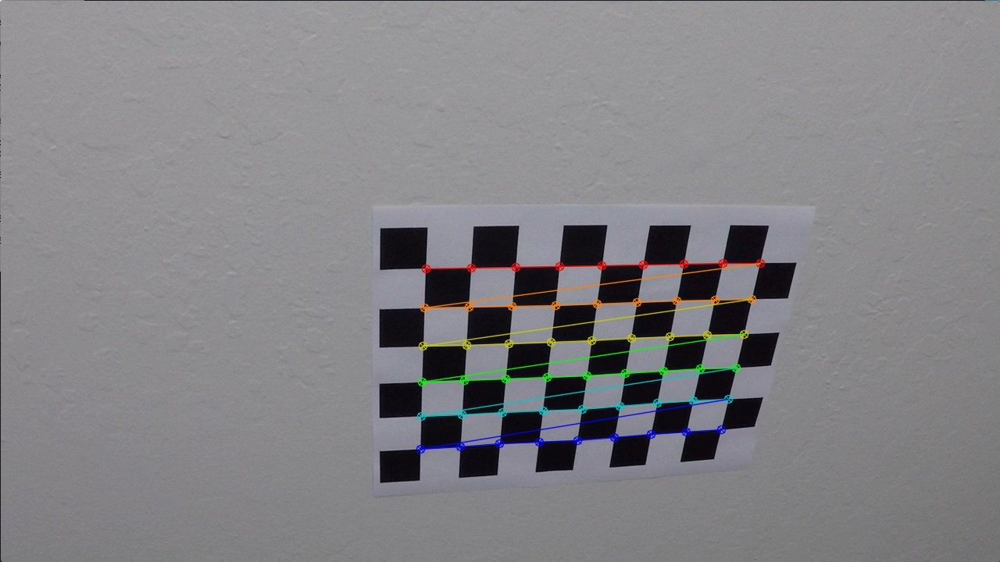
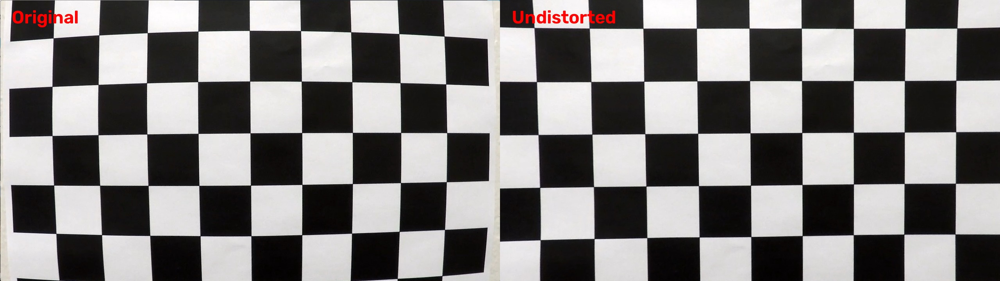
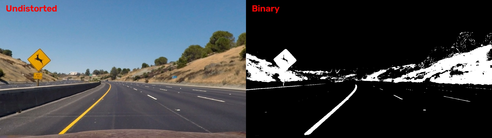
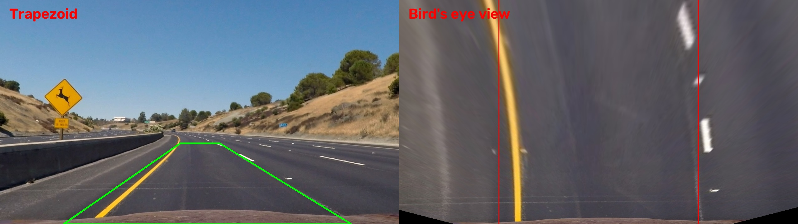
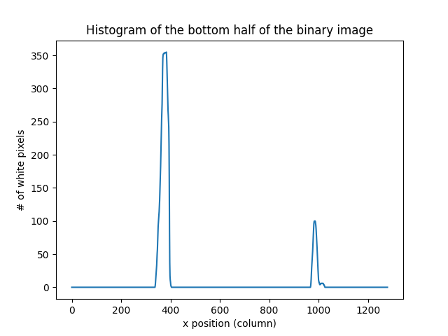
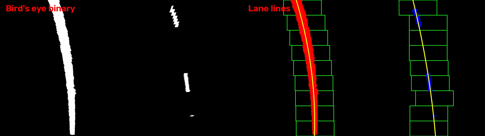
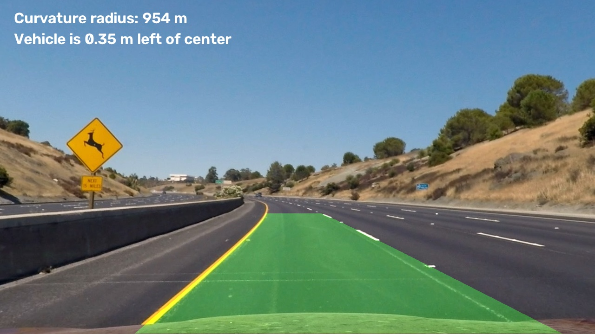

## Writeup Template

### You use this file as a template for your writeup.

---

**Lane Finding Project**

The goals / steps of this project are the following:

* Compute the camera calibration matrix and distortion coefficients given a set of chessboard images.
* Apply a distortion correction to raw images.
* Use color transforms, gradients, etc., to create a thresholded binary image.
* Apply a perspective transform to rectify binary image ("birds-eye view").
* Detect lane pixels and fit to find the lane boundary.
* Determine the curvature of the lane and vehicle position with respect to center.
* Warp the detected lane boundaries back onto the original image.
* Output visual display of the lane boundaries and numerical estimation of lane curvature and vehicle position.

---

### Writeup / README

#### 1. Provide a Writeup that includes all the rubric points and how you addressed each one.

You're reading it!

The code is split into a few short scripts. All the image processing functions are in one file, ```lane_pipeline.py```, and the scripts only call them.
Below are the files and their descriptions.

* ```calibration.py``` - camera calibration from the chessboard images, saves ```camera_cal/calib.npz```
* ```lane_pipeline.py``` - all the pipeline functions (undistortion, binary image, perspective transform, lane search, curvature, drawing)
* ```steps_demo.py``` - runs the steps one by one on every image and saves the pictures to output_images/<step>/
* ```images.py``` - runs the whole pipeline on every test image, results in output_images/result/
* ```video.py``` - runs the whole pipeline on every test video, results in output_videos/

One example of every step is also copied to docs/ for this README.

### Camera Calibration

#### 1. Briefly state how you computed the camera matrix and distortion coefficients. Provide an example of a distortion corrected calibration image.

A camera lens bends straight lines near the edges of the image. The curvature of the lane is computed from the shape of the lane lines, so this distortion has to be removed first.

The calibration is done in ```calibration.py``` with the 20 chessboard photos from camera_cal/:

I prepared the object points: the grid (0,0,0), (1,0,0), ..., (8,5,0) of the 9 x 6 inner corners of the board. They are the same for every photo because the board is flat.
For every photo I converted it to grayscale and called ```cv2.findChessboardCorners```. The corners were found in 17 of 20 photos. They were not found in ```calibration1.jpg```, ```calibration4.jpg``` and ```calibration5.jpg```, because the board is partly outside the frame in those photos.
I refined the corner positions with ```cv2.cornerSubPix```.
I passed all the object points and image points to ```cv2.calibrateCamera```, which returned the camera matrix and the distortion coefficients. They are saved in ```camera_cal/calib.npz```, so the calibration does not have to be repeated every time.

[image1]: ./docs/corners_example.jpg "Calibration"


### Pipeline (single images)

#### 1. Provide an example of a distortion-corrected image.

The correction is done by the function undistort in ```lane_pipeline.py``` with ```cv2.undistort```. I pass the camera matrix also as the new camera matrix, so the corrected image has the same size and geometry as the original. This is important because the points of the perspective transform later are fixed pixel positions. (The alternative, ```cv2.getOptimalNewCameraMatrix```, returns a different matrix and can leave black borders.)

The calibration was computed for 1280 x 720 images. For an image of another size the function scales the matrix (```fx```, ```cx``` by ```width / 1280``` and ```fy```, ```cy``` by ```height / 720```). 

This image shows the difference between original and undistorted image



#### 2. Describe how (and identify where in your code) you used color transforms, gradients or other methods to create a thresholded binary image.  Provide an example of a binary image result.

The binary image is made by the function ```threshold_binary``` (with ```sobel_x_binary```) in ```lane_pipeline.py```. The road has yellow and white lines, light and dark asphalt and shadows, so I combine colour and gradient:

Colour: in the HSV colour space I select yellow pixels (hue 15-35, saturation 80-255, value 100-255) and white pixels (saturation 0-40, value 200-255) with ```cv2.inRange```.
Gradient: the Sobel operator in the x direction (```cv2.Sobel```, kernel 3) on the lightness channel of the HLS space, after a 5 x 5 Gaussian blur. The lane lines are mostly vertical, so the x gradient highlights them. I keep the pixels with absolute gradient from 30 to 255.
The gradient is used only where the saturation channel (HLS) is between 100 and 255. This removes many weak edges on the grey asphalt.
The final binary image is ```colour OR (gradient AND saturation)```.

The colour part finds the lines in normal light, and the gradient part helps where a line is in shadow and its colour is weaker.

The binary image contains a lot of noise outside of the road (the yellow sign, the dry grass on the hill, the white fence). This is not a problem, because the perspective transform in the next step keeps only the part of the image in front of the car.



#### 3. Describe how (and identify where in your code) you performed a perspective transform and provide an example of a transformed image.

In the camera image the lane lines converge towards the horizon, so the lane width and the curvature cannot be measured there. The function ```warper``` in ```lane_pipeline.py``` maps a trapezoid on the road to a rectangle with ```cv2.getPerspectiveTransform``` and ```cv2.warpPerspective```. In the result the lines are parallel on a straight road. The binary image is warped with ```INTER_NEAREST``` (the values stay 0 and 255) and the colour image with ```INTER_LINEAR```.

The points for image (```SRC_REF``` and ```DST_REL``` in ```lane_pipeline.py```):
* top left (578, 460), (320, 0)
* bottom left (203, 720),	(320, 720)
* bottom right (1127, 720), (960, 720)
* top right (704, 460), (960, 0)

I started from a trapezoid that is commonly used for this camera setup and checked it on the two images with straight lines (```straight_lines1.jpg```, ```straight_lines2.jpg```). On a straight road the lines in the bird's eye view must be parallel and vertical, so I measured the x position of each line in four horizontal bands. The lines were slowly moving apart towards the top (the right line by about 45 px), so I moved the two top points outwards (585 -> 578 and 695 -> 704). After that the position of each line changed by only 2 to 17 px between the top and the bottom of the image, and the lane was about 620 px wide in both images. For other image sizes the same trapezoid is only scaled (```get_points```).

The inverse matrix ```Minv = cv2.getPerspectiveTransform(dst, src)``` is used later to draw the lane back on the camera image.

The red lines are the ideal positions of the two lane lines. The black triangles at the bottom corners are the places where the original image has no pixels.



#### 4. Describe how (and identify where in your code) you identified lane-line pixels and fit their positions with a polynomial?

This is done by ```find_lane_lines``` in ```lane_pipeline.py``` on the warped binary image:

Histogram. I sum the white pixels in every column of the bottom half of the image. The two highest peaks (one in the left half and one in the right half) are the starting x positions of the left and right line.
Sliding windows. The image is divided into 9 horizontal levels. Starting at the bottom, I place a window (200 px wide, ```MARGIN = 100```) around the current x position of each line and collect the white pixels inside. If there are more than 50 pixels (```MINPIX```), the next window is centred on their mean x position, so the windows follow the curve of the line.
Polynomial. All the collected pixels of one line are used in ```np.polyfit(y, x, 2)```, which gives ```x = A*y^2 + B*y + C```. I fit x as a function of y, because the lines are almost vertical.

Histogram of the example image. The right peak is lower, because the right line is dashed:



Windows (green), left line pixels (red), right line pixels (blue) and the fitted polynomials (yellow):



#### 5. Describe how (and identify where in your code) you calculated the radius of curvature of the lane and the position of the vehicle with respect to center.

Both are calculated in ```lane_pipeline.py``` (```meters_per_pixel```, ```curvature_radius```, ```vehicle_offset```).

Pixels to meters. The polynomial is in pixels, but the radius should be in meters. I used two assumptions:

the lane is 3.7 m wide, and in the bird's eye view of a 1280 px wide image it is about 620 px wide (I measured this in the two straight-line images), so ```xm = 3.7 / 620``` meters per pixel,
the visible part of the road is about 30 m long, so ```ym = 30 / 720``` meters per pixel.

The first one is measured. The second one is an assumption that I did not measure. The radius is proportional to ```ym^2```, so if the real length is 20% different, the radius changes by about 44%. The radius values should therefore be read as an estimate of the order of magnitude.

Radius of curvature. I convert the coefficients to meters (```A_m = xm*A/ym^2, B_m = xm*B/ym```) and use the formula for the radius of a curve ```x(y)```:

```R = (1 + (2*A_m*y + B_m)^2)^(3/2) / |2*A_m|```

evaluated at the bottom row of the image (closest to the car). The final value is the mean of the left and the right line. If it is larger than 5000 m the text shows "almost straight".

Vehicle position. I assume that the camera is mounted in the middle of the car, so the car is at the centre of the image (```width / 2```). I take the x position of both polynomials at the bottom row, their mean is the lane centre, and the difference to the image centre multiplied by ```xm``` is the offset in meters (positive = the car is right of the lane centre).

On the two images with straight roads the radius is very large and the offset is close to zero, as it should be. On the curved roads the radius is around 1 km, which is realistic for a highway. In test1 and test4 the right line is confused by bright pieces of concrete, so those numbers cannot be trusted (see the Discussion).

#### 6. Provide an example image of your result plotted back down onto the road such that the lane area is identified clearly.

The function ```draw_lane``` in ```lane_pipeline.py``` draws the area between the two polynomials in green on an empty image (```cv2.fillPoly```) in the bird's eye view. I warp it back to the camera view with ```Minv``` (```cv2.warpPerspective```) and blend it with the undistorted image (```cv2.addWeighted```). The radius and the offset are written on the image.




### Pipeline (video)

#### 1. Provide a link to your final video output.  Your pipeline should perform reasonably well on the entire project video (wobbly lines are ok but no catastrophic failures that would cause the car to drive off the road!).

* [project_video03_result.mp4](docs/project_video03_result.mp4)
* [challenge01_result.mp4](docs/challenge01_result.mp4)

### Discussion

#### 1. Briefly discuss any problems / issues you faced in your implementation of this project.  Where will your pipeline likely fail?  What could you do to make it more robust?

The problems appear in the parts of the road where the asphalt is lighter and where the curves are sharp.

Light asphalt. On a light road surface, and on light patches inside the lane, bright pieces of concrete pass through the white colour threshold. The dashed line has few pixels, so this noise can pull the polynomial away from the real line. 
Sharp curves. In very sharp curves the left and the right line are not recognised well. The sliding windows are 200 px wide, the polynomial is of second order and the transform covers only a fixed part of the road in front of the car, so a sharp bend leaves the area or cannot be described by one parabola. 


What could be done to make it more robust?

The algorithm would be more robust if it moved the source points of the perspective transform automatically, depending on the slope of the road or on the speed of the vehicle.
Use an adaptive threshold for the brightness (for example relative to the brightness of the road in front of the car), so bright concrete and shadows are not taken for a line.
Search for the lane around the polynomial from the previous frame instead of starting from the histogram in every frame, and use a polynomial of higher order or shorter segments for sharp curves.
The algorithm should be extended to work well on videos with more noise and in the case of sharp curves.

